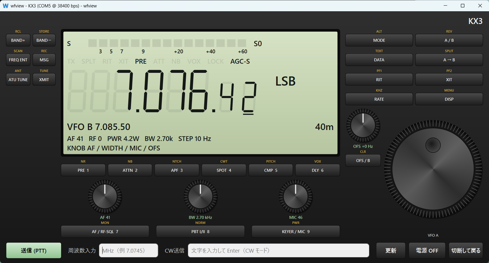
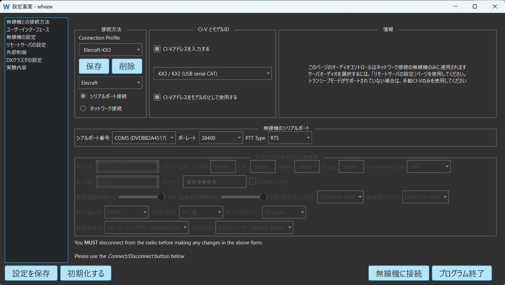
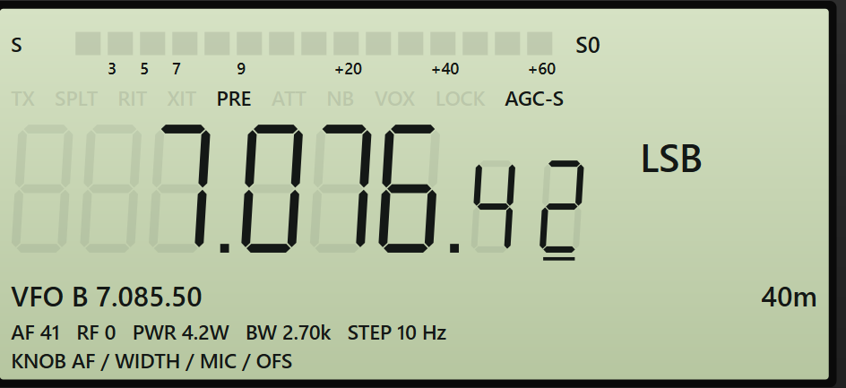
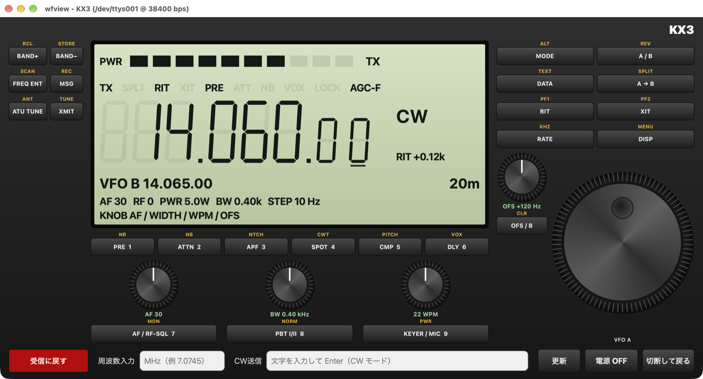

# wfview-win Elecraft KX3 操作説明書

更新日: 2026-10-22（wfview-win、実機 KX3 を接続して画面を撮影）

## 1. 概要

wfview-win は、Elecraft KX3 を USB シリアル CAT ケーブルで Windows PC につなぎ、本体の前面パネルと同じ配置の専用画面（以下「KX3 画面」）で操作できます。

KX3 画面でできること:

- 本体前面の 22 個のキーと、つまみの押しボタン 4 個の操作（短く押す・長押しの両方）
- 周波数の変更（VFO A ダイヤル、周波数の桁クリック、周波数入力欄、BAND+ / BAND−、OFS/B つまみで VFO B）
- モードの切り替え（LSB / USB / CW / CW-R / AM / FM / DATA / DATA-R）
- VFO A / B の入れ替え・コピー、スプリット、RIT / XIT とオフセット
- AF ゲイン、RF ゲイン、スケルチ、帯域幅、シフト、マイクゲイン、キーヤー速度、送信出力の調整
- 送信（PTT）と受信の切り替え、CW の文字送信
- 電源 OFF
- S メーター、送信時の出力、各種表示（PRE、ATT、NB、VOX、LOCK、AGC、NR、APF など）の表示

KX3 は CAT で受信音や送信音を送れないため、音声は無線機のスピーカー・マイク（またはヘッドホン端子など）を使います。

## 2. 準備

### 2.1 必要なもの

- Elecraft KX3 本体
- USB シリアル CAT ケーブル（Elecraft KXUSB、または ACC1 端子用の互換ケーブル）
- wfview-win をインストールした Windows PC

ケーブルを挿すと、Windows がドライバーを自動で入れ、`COM5` のような COM ポートが現れます。

- 純正の KXUSB（FTDI チップ）は、`USB Serial Port (COMx)` という名前で現れます。
- Prolific 製チップ（PL2303 系）の互換ケーブルは、`Prolific PL2303GT USB Serial COM Port (COMx)` のような名前で現れます。

ポートの番号は、デバイスマネージャー（スタートボタンを右クリック → デバイスマネージャー）の **ポート (COM と LPT)** で確認できます。黄色の「!」が付いている場合は、ケーブルのメーカー（Prolific の場合は Prolific Technology Inc. の Web サイト）からドライバーを入れ、ケーブルを挿し直してください。

### 2.2 無線機側の設定

1. ケーブルを KX3 の ACC1 端子（3.5mm ステレオジャック）に挿します。
2. KX3 のメニュー **RS232** で通信速度を選びます（4800 / 9600 / 19200 / 38400 bps。工場出荷時は 4800 bps）。38400 bps をおすすめします。
3. 通常は他の CAT 関連の設定を変える必要はありません。

## 3. 接続

### 3.1 起動すると設定画面が開きます

wfview-win を起動すると、最初は設定画面だけが開きます。起動しただけでは無線機に接続しません。

### 3.2 接続の設定

設定画面の左のリストで「無線機との接続方法」を選び、次のように設定します。

| 項目 | 設定内容 |
|---|---|
| メーカー（接続方法欄のプルダウン） | `Elecraft` |
| 接続方式 | `シリアルポート接続` |
| CI-V とモデルID の機種欄 | `KX3 / KX2 (USB serial CAT)`（メーカーを `Elecraft` にすると自動で選ばれます） |
| シリアルポート番号 | CAT ケーブルの COM ポート（例: `COM5`） |
| ボーレート | 無線機の RS232 メニューと同じ値（4800 / 9600 / 19200 / 38400） |
| PTT Type | そのままでかまいません（KX3 画面では CAT コマンドで送信します） |

- 機種の欄の候補は、メーカーを `Elecraft` にすると `KX3 / KX2 (USB serial CAT)` だけになります。
- `ネットワーク接続` には対応していません。必ず `シリアルポート接続` を選びます。

### 3.3 接続プロファイルに保存する

`Connection Profile` の欄に名前（例: `KX3`）を入れて `保存` を押すと、上の設定を名前を付けて保存できます。次回からは一覧で選ぶだけで設定が読み込まれます。

- 設定画面を開くたびに、選択中のプロファイルの内容が読み込まれます（無線機に接続中は読み込みません）。
- 不要になったプロファイルは、選んで `削除` を押します。
- 画面下の `設定を保存` を押すと、その他の設定も含めて保存されます。

### 3.4 無線機に接続する

1. KX3 の電源を入れます（CAT では電源を入れられません）。
2. 設定画面の右下にある `無線機に接続` を押します。
3. KX3 画面が開き、LCD に周波数とモードが表示されれば通信できています。

ウインドウのタイトルには、使っているポートと通信速度が表示されます（例: `wfview - KX3 (COM5 @ 38400 bps)`）。KX2 を接続した場合は、自動で KX2 と判別し、タイトルと画面右上の表示が `KX2` になります。

LCD に「ポート未接続」や「CAT 応答待ち（電源・ボーレート・ケーブルを確認）」と出る場合は、[9. トラブルシューティング](#9-トラブルシューティング) を見てください。

### 3.5 切断して設定画面に戻る

KX3 画面の右下にある `切断して戻る` を押すと、無線機から切断して KX3 画面を閉じ、設定画面に戻ります。設定を変えて、もう一度 `無線機に接続` で接続し直せます。

KX3 画面をウインドウの閉じるボタンで閉じた場合も、送信中なら受信に戻してからシリアルポートを閉じます。

接続中は、送信出力を 0.1 W 単位で読み書きするため、本体の CAT の設定（K2 拡張モード）を一時的に変えます。切断するときに、接続前の設定に戻します。

## 4. KX3 画面の各部

### 4.1 全体の配置

キーとつまみは本体と同じ配置です。キーの上の黄色い小さな文字は、そのキーを長押ししたときの機能です。

| 場所 | 部品 |
|---|---|
| 左上 | `BAND+` `BAND−` `FREQ ENT` `MSG` `ATU TUNE` `XMIT` |
| 中央 | LCD（S メーター・各種表示・周波数・モード・VFO B・バンド・設定値） |
| LCD の下 | `PRE 1` `ATTN 2` `APF 3` `SPOT 4` `CMP 5` `DLY 6` |
| その下 | 小さなつまみ 3 個（AF / RF-SQL、PBT I/II、KEYER / MIC）と、それぞれの押しボタン |
| 右上 | `MODE` `DATA` `RIT` `RATE`（左の列）、`A / B` `A → B` `XIT` `DISP`（右の列） |
| 右下 | OFS / B つまみと押しボタン、VFO A ダイヤル |
| 最下段 | `送信 (PTT)`、周波数入力欄、CW 送信欄、`更新`、`電源 OFF`、`切断して戻る` |

### 4.2 LCD の表示

| 表示 | 内容 |
|---|---|
| 最上段のバー（`S`） | 受信中は信号の強さを 15 段で表示します。目盛りは S3 / S5 / S7 / S9 / +20 / +40 / +60 です。右に S 値（例: `S0`、`S9+10`）を表示します |
| 最上段のバー（`PWR`） | 送信中は出力を 10 段で表示し、右に `TX` と表示します |
| `TX` | 送信中 |
| `SPLT` | スプリット（VFO B で送信）が ON |
| `RIT` / `XIT` | RIT / XIT が ON |
| `PRE` / `ATT` | プリアンプ / アッテネーターが ON |
| `NB` / `VOX` / `LOCK` | ノイズブランカー / VOX / VFO ロックが ON |
| `AGC-F` / `AGC-S` | AGC の速さ（F: 速い、S: 遅い） |
| 周波数（大きな数字） | VFO A。10 Hz の桁まで表示します（下 2 桁は小さく表示）。下線の付いた桁が、ダイヤル 1 目盛りの変化量（ステップ）です |
| モード | LSB / USB / CW / CW-R / AM / FM / DATA / DATA-R |
| DATA のサブモード | DATA / DATA-R のとき、モードの下に DATA A / AFSK A / FSK D / PSK D を表示します |
| `RIT ±x.xxk` / `XIT ±x.xxk` | RIT / XIT が ON のとき、オフセット（kHz）を表示します |
| `VFO B` | VFO B の周波数 |
| バンド（例: `15m`） | 現在のバンド（160m〜6m） |
| `AF` `RF` `PWR` `BW` `STEP` | AF ゲイン（0〜60）、RF ゲイン（0〜−60 dB）、送信出力、受信帯域幅、ダイヤルのステップ |
| `NR` `APF` | ノイズリダクション / オーディオピークフィルタが ON のときだけ表示します |
| `KNOB` | 4 つの小さなつまみに今割り当てられている機能（左から AF/RF-SQL、PBT、KEYER/MIC、OFS/B） |

## 5. 操作

### 5.1 キーの押し方

KX3 画面のキーは、本体のキーと同じく 2 通りの押し方があります。

- **短く押す**: キーに書かれた機能（例: `BAND+`）
- **長押し（0.5 秒以上）**: キーの上の黄色い機能（例: `RCL`）

キーを押すと、本体の同じキーを押したのと同じ命令を KX3 に送ります。押した後、本体の状態を読み直して LCD の表示を合わせます。各機能の詳しい動きは、KX3 本体の取扱説明書（KX3 Owner's Manual）を参照してください。

### 5.2 前面パネルのキー

| キー | 短く押す | 長押し |
|---|---|---|
| `BAND+` | 上のバンドへ | `RCL`（メモリーの呼び出し） |
| `BAND−` | 下のバンドへ | `STORE`（メモリーへの書き込み） |
| `FREQ ENT` | キーパッドで周波数を入力（[5.4](#54-周波数を変える) 参照） | `SCAN`（スキャン） |
| `MSG` | 録音したメッセージの再生 | `REC`（メッセージの録音） |
| `ATU TUNE` | 内蔵 ATU でチューニング（短時間送信します） | `ANT`（アンテナ切替） |
| `XMIT` | 送信 / 受信の切替（`送信 (PTT)` と同じ） | `TUNE`（チューン送信） |
| `PRE 1` | プリアンプ ON / OFF | `NR`（ノイズリダクション） |
| `ATTN 2` | アッテネーター ON / OFF | `NB`（ノイズブランカー） |
| `APF 3` | オーディオピークフィルタ（CW） | `NTCH`（ノッチ） |
| `SPOT 4` | CW スポット（相手の信号に合わせる） | `CWT`（CW チューニング表示） |
| `CMP 5` | スピーチコンプレッサ | `PITCH`（CW ピッチ） |
| `DLY 6` | 送受切替ディレイ（QSK / VOX） | `VOX` |
| `MODE` | モードの切替 | `ALT`（逆サイドバンドなど） |
| `DATA` | DATA モード | `TEXT`（文字デコード） |
| `RIT` | RIT ON / OFF | `PF1`（プログラマブルキー 1） |
| `RATE` | ダイヤルの変化量の切替 | `KHZ` |
| `A / B` | VFO A と B の入れ替え | `REV`（FM レピーターのリバース） |
| `A → B` | VFO A の周波数を B へコピー | `SPLIT`（スプリット ON / OFF） |
| `XIT` | XIT ON / OFF | `PF2`（プログラマブルキー 2） |
| `DISP` | 表示の切替 | `MENU`（メニュー） |

キー名の後の数字（`PRE 1` の `1` など）は、`FREQ ENT` などで本体がキーパッド入力を待っているときに、そのキーが表す数字です。

### 5.3 つまみ

小さなつまみは、本体と同じく、下の押しボタンを短く押すたびに回したときの機能が切り替わります。今の機能は、つまみの下の緑色の文字と、LCD の `KNOB` 行で確認できます。

| つまみ | 回したときの機能 | 押しボタン（短く押す） | 押しボタン（長押し） |
|---|---|---|---|
| AF / RF-SQL 7 | AF ゲイン（0〜60） ⇔ RF ゲイン（0〜−60 dB）。FM のときは RF の代わりにスケルチ（0〜29） | 機能の切替 | `MON`（モニター） |
| PBT I/II 8 | 帯域幅（I、50 Hz ずつ） ⇔ シフト（II、通過帯域の中心、10 Hz ずつ） | 機能の切替 | `NORM`（通過帯域を標準に戻す） |
| KEYER / MIC 9 | CW ではキーヤー速度（8〜50 WPM）、それ以外はマイクゲイン | `PWR` から元の機能へ戻す | `PWR`（送信出力、0.1 W ずつ。最大 15 W） |
| OFS / B | RIT / XIT のオフセット ⇔ VFO B の周波数（VFO A と同じステップ） | 機能の切替 | `CLR`（オフセットを 0 に） |

つまみは、次のどれでも操作できます。

- ドラッグして回す
- マウスホイールを回す
- 右半分をクリックで 1 目盛り上、左半分をクリックで 1 目盛り下

OFS / B つまみでオフセットを変えるときは、1 目盛りで本体の RIT のステップ 1 つ分（本体の RATE の設定によって 1〜50 Hz）変わります。

### 5.4 周波数を変える

| 方法 | 操作 |
|---|---|
| VFO A ダイヤル | ドラッグして回す、マウスホイールを回す、右半分をクリックで 1 ステップ上、左半分をクリックで 1 ステップ下 |
| 周波数の桁クリック | LCD の周波数の桁をクリックすると、その桁がダイヤルのステップになります（例: 100 Hz の桁 → 100 Hz ステップ） |
| 周波数入力欄 | 最下段の `周波数入力` に MHz 単位で入力して Enter（例: `7.0745`）。0.5〜54 MHz の範囲外は受け付けません |
| `BAND+` / `BAND−` | 本体のバンド切替と同じです。バンドごとに最後に使った周波数とモードに戻ります |
| OFS / B つまみ | VFO B の機能にすると、VFO B の周波数を変えられます |

周波数を直接入力するときは、`周波数入力` 欄を使ってください。`FREQ ENT` のキーパッド入力のうち、`7` `8` `9`（つまみの押しボタン）と `0`（`XMIT`）は、KX3 画面からは数字として送れません。特に `XMIT` は送信になるので、キーパッド入力中に押さないでください。

### 5.5 モードを変える

`MODE` を短く押すたびに、本体のモードが切り替わります（本体の `MODE` キーと同じ順番です）。`MODE` の長押し（`ALT`）で、LSB ⇔ USB、CW ⇔ CW-R、DATA ⇔ DATA-R などを切り替えます。

`DATA` を短く押すと DATA モードになります。サブモード（DATA A / AFSK A / FSK D / PSK D）は、本体の操作で選びます（本体の `DATA` をもう一度押し、本体の OFS / VFO B つまみを回します）。KX3 画面の OFS / B つまみは VFO B やオフセットを変えるつまみなので、サブモードの選択には使えません。今のサブモードは LCD のモードの下に表示されます。

### 5.6 VFO A / B とスプリット

| 操作 | 内容 |
|---|---|
| `A / B` | VFO A と VFO B の周波数を入れ替えます |
| `A → B` | VFO A の周波数を VFO B にコピーします |
| `A → B` の長押し（`SPLIT`） | スプリット ON / OFF。ON のときは VFO A で受信、VFO B で送信します（LCD に `SPLT`） |

### 5.7 RIT / XIT

1. `RIT`（または `XIT`）を短く押すと ON になり、LCD に `RIT`（`XIT`）が点灯して、オフセットが表示されます。
2. OFS / B つまみがオフセットの機能（緑色の文字が `OFS`）になっていることを確認して、つまみを回します。
3. OFS / B の押しボタンの長押し（`CLR`）で、オフセットを 0 に戻します。
4. もう一度 `RIT`（`XIT`）を押すと OFF になります。

### 5.8 送信する

最下段の `送信 (PTT)`、または `XMIT` を短く押すと送信し、`送信 (PTT)` が赤い `受信に戻す` に変わります。もう一度押すと受信に戻ります。

（この画像は、送信中の表示を説明するための例で、Mac 版で実機の代わりに試験用のプログラムをつないで撮影しました。Windows 版も同じ表示です。）

- 送信中は、LCD 最上段のバーが送信出力（`PWR`）の表示になり、`TX` が点灯します。
- 安全のため、連続送信は 3 分で自動的に止まります。本体側の操作や `TUNE`・`ATU TUNE` で送信になった場合も同じです。
- 送信する前に、周波数・モード・出力・アンテナ（またはダミーロード）を必ず確認してください。

### 5.9 CW の文字送信

1. モードを CW（または CW-R）にします。
2. 最下段の `CW送信` 欄に文字を入力して Enter を押すと、本体のキーヤーで送信します。

- 使える文字は、英字・数字・空白と `/ ? . , = + -` です。英小文字は大文字にして送ります。それ以外の文字は送りません。
- 送信速度は、KEYER / MIC つまみ（CW のとき WPM）で設定したキーヤー速度です。
- CW 以外のモードで Enter を押すと、「CW 送信は CW / CW-R モードで使用してください。」と表示され、送信しません。

### 5.10 電源 OFF

`電源 OFF` を押すと「無線機の電源を OFF にして、プログラムを終了しますか？（電源 ON は本体の操作が必要です）」と確認が出ます。

- `はい` を押すと、無線機の電源を切ってから wfview-win も終了します。設定を保存していない場合は、終了前に保存するかどうか聞かれます。
- 電源を入れるときは、本体の電源スイッチを使ってください（CAT では電源を入れられません）。

### 5.11 表示を更新する

無線機本体のつまみやメニューで設定を変えたときは、最下段の `更新` を押すと、本体の状態をすべて読み直して表示を合わせます。

周波数・モード・S メーター・送信状態は常に自動で読み直しています。その他の設定（AF / RF ゲイン、出力、帯域幅など）も、数秒ごとに順番に読み直しています。

### 5.12 本体のメニュー

`DISP` の長押し（`MENU`）で本体のメニューに入れますが、メニューの項目と値は KX3 画面の LCD には表示されません。メニューの操作は、本体の表示を見ながら本体のつまみで行ってください。

## 6. KX2 について

KX2 を接続した場合は、自動で KX2 と判別し、画面の表示が `KX2` になります。

- 周波数、つまみ（AF / RF / スケルチ、帯域幅 / シフト、マイク / キーヤー速度 / 出力、オフセット / VFO B）、送信、CW 文字送信、電源 OFF は、KX3 と同じように使えます。送信出力の上限は 12 W です。
- 前面パネルのキー（22 個のキーと、AF / RF-SQL の押しボタンの長押し `MON`）は、KX2 では使えません。KX2 は本体のキーの配置と命令が KX3 と違うためです。押すと記録に「KX2 ではこのキーは未対応です」と書かれ、何もしません。

## 7. 終了

- KX3 画面の `電源 OFF` で無線機の電源を切ると、wfview-win も終了します。
- 無線機の電源を入れたまま終了するときは、`切断して戻る` で設定画面に戻り、`プログラム終了` を押します。
- 終了するときは「プログラムを終了しますか？」と確認が出ます。設定を保存していないときは「設定が保存されていません。このまま終了しますか？」と出るので、`保存` を押すと保存してから終了します。

## 8. 他のソフトと併用するとき

KX3 のシリアルポートは、同時に 1 つのソフトしか使えません。QSOLogWin、KX3 Utility、その他の CAT ソフトがポートを使っているときは、それを終了してから `無線機に接続` を押してください。

## 9. トラブルシューティング

| 症状 | 確認すること |
|---|---|
| メーカーに `Elecraft` が出ない | KX3 に対応した wfview-win（2026-10-22 以降のビルド）に更新してください |
| シリアルポートの一覧にケーブルが出ない | デバイスマネージャーの「ポート (COM と LPT)」にケーブルが出ているか確認します（[2.1](#21-必要なもの)）。出ていない、または「!」が付いている場合はドライバーを入れ直し、ケーブルを挿し直します。別の USB 端子やハブも試します |
| LCD に「ポート未接続」と出る | シリアルポートの選択を確認します。他のアプリがそのポートを使っていないか確認します（[8](#8-他のソフトと併用するとき)） |
| LCD に「CAT 応答待ち」と出る | 無線機の電源、ボーレート（RS232 メニューと同じか）、ケーブルの差し込み（ACC1 端子）を確認します |
| 周波数が変わらない | 本体の VFO ロック（LCD の `LOCK`）が ON になっていないか確認します |
| キーを押しても反応しない | 本体がメニュー表示中などで、そのキーを受け付けない状態のことがあります。本体の表示を確認し、通常の表示に戻してから押します |
| つまみを回しても値が変わらない | つまみの下の緑色の文字で、今の機能を確認します。押しボタンを短く押すと機能が切り替わります |

動作の記録は、Windows の一時フォルダ（`%TEMP%`）の `wfview-日時.log` に書き出されます（KX3 画面のメッセージは `KX3:` で始まります）。

## 10. 安全上の注意

このアプリは無線機を送信状態にできます。`送信 (PTT)`、`XMIT`、`TUNE`、`ATU TUNE`、CW 送信を操作する前に、周波数、出力、アンテナ、免許の条件、周囲への影響を必ず確認してください。
